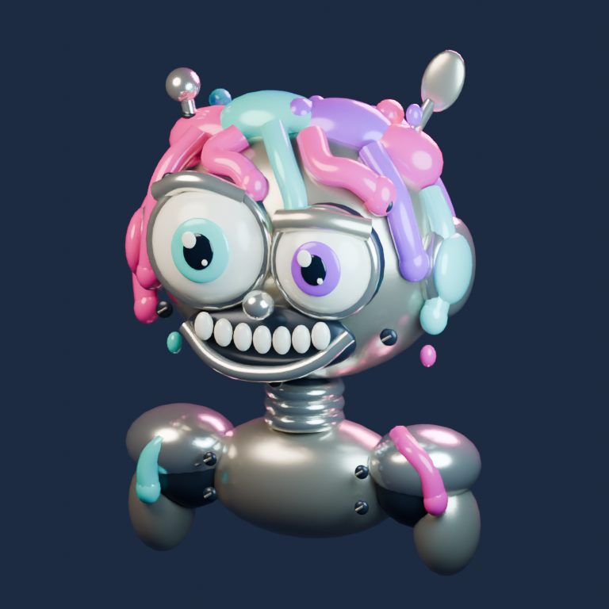

# Cartoon AI — animacje tworzone kodem z pomocą ChatGPT

Czy da się tworzyć krótkie filmy z pomocą AI, generując **kod, który buduje scenę i ją animuje**? To właśnie sprawdzam w tym repozytorium.

Projekt powstał przez rozmowy z **ChatGPT w trybie Work**, połączonym z publicznym repozytorium GitHub. Opisywałem, co chciałem zobaczyć, oglądałem kolejne wersje i zgłaszałem poprawki. W ten sposób powstały dwie bajki o kotku i tańczący robot 3D.

## Obejrzyj trzy gotowe animacje

Wystarczy przeglądarka — nie trzeba instalować projektu ani programów do animacji.

| Animacja | Co zobaczysz | Otwórz |
| --- | --- | --- |
| **Kotek i motyl** · 65 sekund · 2D | Krótka historia o spotkaniu kotka z motylem i pomaganiu przyjacielowi. | [Obejrzyj bajkę](https://kpok.github.io/cartoon_ai/?story=meadow&lang=pl) |
| **Kotek i małe nasionko** · 90 sekund · 3D | Edukacyjna bajka o tym, że rośliny potrzebują wody, światła i czasu. | [Obejrzyj bajkę](https://kpok.github.io/cartoon_ai/?story=garden&lang=pl) |
| **Neonowy robot** · 40 sekund w pętli · 3D | Robot z dużą głową, krótkimi kończynami, mimiką i tańcem na tle zielonego deszczu cyfr. Model można obracać także podczas tańca. | [Obejrzyj robota](https://kpok.github.io/cartoon_ai/robot.html) |

[Otwórz całą bibliotekę na GitHub Pages](https://kpok.github.io/cartoon_ai/).

Bajki mają wersję polską i angielską oraz wybór kadru poziomego lub pionowego. Odtwarzanie uruchamia się przyciskiem. Sceny 3D wymagają przeglądarki z obsługą WebGL2; robot ma również podgląd PNG.

## Skąd wziął się pomysł

Chciałem spróbować tworzenia krótkich filmów przy użyciu AI. Koszt generowania wideo, zwłaszcza przy kolejnych próbach i poprawkach, wydawał mi się jednak zbyt wysoki na taki eksperyment.

Pomyślałem więc: **a gdyby poprosić AI o napisanie programu, który sam stworzy animację?**

Kod opisuje postacie, scenę, ruchy, kamerę i przebieg wydarzeń. Przeglądarka odtwarza animację na podstawie tego kodu. Można też wyrenderować kolejne klatki i złożyć je w MP4. Poprawka tempa, gestu czy tła staje się kolejną zmianą w projekcie.

To był cel eksperymentu: sprawdzić, jak daleko można dojść od opisu pomysłu do działającego filmu za pomocą kodu tworzonego wspólnie z AI.

## Jak pracowałem — vibe coding przez rozmowę

Nie pisałem ręcznie kodu. Nie otwierałem go też, żeby go przeglądać ani samodzielnie poprawiać. Sterowałem projektem opisowo, przez rozmowę z ChatGPT Work.

Mój udział polegał na wymyślaniu scenariuszy, opisywaniu oczekiwanego efektu i oglądaniu kolejnych wersji. Mówiłem na przykład, że bajka jest za wolna, robot powinien mieć krótsze nóżki, głowa ma przesuwać się na boki, a machnięcie dłonią powinno wypadać w konkretnym momencie.

ChatGPT przekładał te uwagi na zmiany w repozytorium: przygotowywał kod, modele proceduralne, animacje, testy, eksportery oraz workflow GitHub Actions. Kolejne wersje trafiały na GitHub i GitHub Pages, gdzie mogłem zobaczyć rezultat i zgłosić następne uwagi. Pracowałem w ten sposób również z przeglądarki i aplikacji ChatGPT na Androidzie.

W miarę rozwoju projektu doszły planowanie, przeglądy z udziałem agentów, automatyczne testy oraz audyt repozytorium. Moja ocena dotyczyła przede wszystkim efektu wizualnego. Testy i przeglądy pomagają wykrywać błędy, ale nie są gwarancją poprawności ani zastępstwem dla oceny praw do używanych materiałów.

## Od obrazu koncepcyjnego do modelu 3D

Poniżej obraz koncepcyjny wygenerowany w ChatGPT, na którym wzorowaliśmy wygląd robota, oraz podgląd modelu utworzonego proceduralnie w Blenderze.

| Obraz koncepcyjny — wygenerowany w ChatGPT | Model proceduralny — render z Blendera |
| --- | --- |
|  |  |

Kolorystyka, duża głowa i charakter postaci były inspiracją do budowy geometrii i materiałów. Krótkie nogi, ruchy i mimika powstawały później w kolejnych iteracjach kodu. Obraz koncepcyjny jest ilustracją referencyjną; jego zasady udostępniania opisuje [mapa licencji](LICENSING.md).

[Otwórz animowany model i obróć go w 3D](https://kpok.github.io/cartoon_ai/robot.html).

## Jak działa rozwiązanie

1. **Opisuję pomysł i poprawki** w rozmowie z ChatGPT Work.
2. **ChatGPT przygotowuje zmiany w kodzie** i plikach projektu w repozytorium GitHub.
3. **Kod tworzy scenę i animację** — postacie, geometrię, materiały, ruchy oraz ustawienia kamery.
4. **GitHub Actions wykonuje kontrole**, a po odpowiednich sprawdzeniach publikuje stronę na GitHub Pages.
5. **Oglądam wynik w przeglądarce** i opisuję kolejne zmiany.
6. **Osobny, ręcznie uruchamiany workflow eksportuje MP4**, który można następnie wykorzystać do publikacji.

Odtwarzanie i eksport działają bez wywoływania płatnego API do generowania wideo. Przy robocie wykorzystałem też obraz referencyjny wygenerowany wcześniej w ChatGPT; model 3D powstaje proceduralnie i jest animowany kodem.

| Technologia | Zastosowanie |
| --- | --- |
| JavaScript i Canvas 2D | Pierwsza bajka oraz logika odtwarzania. |
| Three.js i WebGL | Ogród 3D, podgląd robota, oświetlenie, kamera i animacja w przeglądarce. |
| Blender i Python | Proceduralne tworzenie modelu robota. |
| GLB / glTF | Zapis modelu i animacji robota do odtwarzania w przeglądarce. |
| Node.js, Playwright i FFmpeg | Renderowanie klatek i eksport do MP4. |
| GitHub Actions i GitHub Pages | Automatyczne kontrole, ręczne eksporty i hosting podglądu. |

## Dźwięk i publikowanie filmów

W dwóch bajkach muzyka jest syntezowana programowo, a dialogi w przeglądarce korzystają z głosów systemowych. Eksport bajek może zawierać muzykę i dialogi generowane lokalnie przez eSpeak NG, dlatego głos w MP4 może różnić się od głosu w przeglądarce.

Podgląd i eksport robota są **bez dźwięku**. Do opublikowanej wersji Facebook Reels dodałem utwór dostępny w edytorze Facebooka. Źródło referencji tańca i zakres wykorzystania materiałów opisuje [dokumentacja pochodzenia zasobów](docs/MEDIA_PROVENANCE.md).

## Co dalej

Każdą animację rozwijam iteracyjnie w rozmowie: od pomysłu, przez pierwszą działającą wersję, po poprawki ruchu, tempa i wyglądu. Repozytorium zachowuje kod, z którego można odtworzyć i dalej rozwijać te sceny.

- [Roadmapa eksperymentu](docs/ROADMAP_PL.md)
- [Eksport robota do MP4](docs/ROBOT_MP4.md)
- [Licencje poszczególnych części projektu](LICENSING.md)
- [Kontrole prywatności, sekretów i zależności](docs/PUBLIC_AUDIT.md)

<details>
<summary>Dokumentacja techniczna: uruchomienie, testy, dźwięk i eksport (English)</summary>

## Local development

Node.js 22 or newer:

```sh
npm ci
npm run dev
```

Open http://localhost:3000. The predev/pretest/build scripts copy the installed Three.js modules and license into `vendor/`; the deployed app loads them from its own origin, with no CDN or runtime API call. The development server binds to all interfaces, for use on trusted networks. ES modules need an HTTP server; opening index.html directly is unsupported.

```sh
npm test
npm run build
npx playwright install --with-deps chromium
npm run test:e2e
```

`dist/` is a standalone static website. To serve it locally, use `SERVE_DIR=dist npm run dev` (adapt environment-variable syntax for your shell). Browser tests run desktop and mobile Chromium with software WebGL enabled for CI, including real 3D renders, backward seeking, episode/language changes, replay and unavailable-WebGL fallback.

## Playback and sound

Play/pause, restart, arbitrary seek, replay and fullscreen are available. Space toggles playback and arrows seek five seconds outside controls. Hiding the page pauses it. Each episode stops at its own duration and never loops automatically.

Music is an original gentle melody synthesized through Web Audio. Short PL/EN dialogue uses the browser's speech synthesis voices; these are not prerecorded AI actors. If a matching voice is unavailable, translated captions remain available. Some system voices may use an online service. Music, dialogue, volume and captions can be changed independently. Audio starts only after a user gesture and stops on pause, seek, story/language change or completion.

No analytics, advertisements, accounts or application API keys are used.

## Implementation

`src/episodes.js` defines episode metadata, dialogue and the accelerated mapping to the original 120-second artwork timeline. That legacy artwork timeline remains in `src/story.js`; the actual first player lasts 65 seconds. `src/garden-state.js` samples the complete garden at an absolute timestamp; `src/garden-view.js` constructs and poses the 3D scene. Backward seeking therefore does not retain future plant growth. `src/app.js` coordinates the selected episode, clock, UI and asynchronous 3D loading. `src/sound.js` accepts the episode duration and dialogue provider.

Garden beats: 0–7 discover seed; 7–15 plant; 15–23 water; 23–30 light; 30–36 patience; 36–48 days/nights; 48–57 sprout; 57–67 leaves; 67–77 more days and flower; 77–85 recap; 85–90 goodbye. Walking is brief and camera/action changes punctuate the episode. MP4 export is described below.

## Deployment

GitHub Actions checks workflow security, model validation, unit tests and build, then deploys that same `dist/` artifact to GitHub Pages after those fast checks succeed on main. By explicit owner choice, full browser/MP4 regression runs in parallel with deployment; check its separate result. Set Pages source to **GitHub Actions** and repository variable `ENABLE_GITHUB_PAGES=true` for deployment. Public pull requests do not start workflows. CI/Pages and manual exports require owner-initiated runs on main; the separate public audit also checks owner pushes to other branches and tags. The deploy job has scoped Pages/OIDC permissions and serialized deployments; no personal access token is needed. Setting the variable to false pauses future publication.

Only the static build is published; project reports, tests and development scripts are excluded. Source and deployed assets are publicly readable. Three.js's MIT license is included with the vendored modules.

## Portrait Shorts / Reels and MP4 export

Choose **Portrait ·9:16 / Pionowo ·9:16** above the player, or add `&format=portrait` to a story link. Both episodes have a dedicated portrait composition; landscape remains available. Changing format pauses at the same time and preserves language. The portrait 2D scene rearranges characters/props; the 3D scene uses a compact stage and portrait camera, rather than cropping the landscape picture.

The exporter renders exact timestamps (no real-time screen recording) and generates MP4 with H.264/yuv420p, AAC sound, 30 FPS and fast-start playback. Default portrait resolution is1080×1920. **Music and dialogue are automatically included by default.** Music is synthesized offline from the original melody. Speech is generated by **eSpeak NG**, a basic synthetic voice, not natural prerecorded AI acting. Browser speechSynthesis is not recorded; web and exported voices may sound different. No API key, paid service or account is used.

Install Node22+, FFmpeg (including ffprobe), eSpeak NG and Playwright Chromium. On Ubuntu:

```sh
sudo apt-get update
sudo apt-get install -y ffmpeg espeak-ng
npm ci
npx playwright install --with-deps chromium
npm run export:mp4 -- --story meadow --lang pl
npm run export:mp4 -- --story garden --lang en
```

Outputs go to `exports/<story>-<lang>-portrait.mp4`, with matching `.srt` subtitles and `.json` metadata. Existing MP4 files are not overwritten. On Windows/macOS install the same official tools, add them to PATH, then use the same npm commands. `FFMPEG_PATH`, `FFPROBE_PATH`, and `ESPEAK_PATH` can specify their executable paths. Do not put credentials in these variables. Export requires more CPU/time than playback, particularly software-rendered3D at1080p.

Options:

```sh
# Fast draft, still full story duration
npm run export:mp4 -- --story garden --lang pl --width 360 --fps 10 --out exports/garden-draft.mp4
# Landscape YouTube edition
npm run export:mp4 -- --story garden --lang en --format landscape --width 1920
# Music and captions, explicitly without voices
npm run export:mp4 -- --story meadow --lang en --dialogue none
# Short test clip: timestamps and audio are offset together
npm run export:mp4 -- --story garden --lang en --from 49 --duration 3 --width 360 --fps 5 --out exports/sprout-test.mp4
```

Captions are burned into the image by default, placed above the lower social-video UI area; `--no-captions` disables burned captions (SRT is still generated). Social apps may place controls differently, so inspect their upload preview. Export contains the scene, captions and garden day label, without website playback controls. No intro/outro is added; durations remain65/90seconds.

### Natural recorded voices

To replace eSpeak with friendly recordings, put one WAV or MP3 per dialogue cue under `<voice-dir>/<story>/<lang>/`. Cue IDs/text/windows come from `episodeCues()` in `src/episodes.js`: meadow-0 through meadow-6; garden-0 through garden-10. For example:

```text
voices/garden/en/garden-0.wav
voices/garden/en/garden-1.wav
...all11 garden cues...
```

```sh
npm run export:mp4 -- --story garden --lang en --dialogue recordings --voice-dir ./voices
```

These files are automatically scheduled, normalized and mixed with ducked music. All recordings must exist, be audible, and fit their cue windows (leave0.08seconds margin). Missing, silent or overlong recordings fail before video rendering; they are never silently omitted/truncated. Default generated TTS may receive a bounded tempo correction up to1.25× to fit a cue. You supply recordings and their usage rights; no AI voice generation/API billing is triggered by this repository. Keep unpublished voice assets outside the public repository until ready to publish.

### GitHub Actions export

Open **Actions → Export cartoon MP4 → Run workflow**. Select story, language, portrait/landscape, full/draft resolution and TTS/music-only. After completion, download the `cartoon-…` artifact ZIP containing MP4, SRT and metadata (retained 1 day). The manual workflow installs all tools; no local setup is needed. It does not publish to YouTube or Facebook and does not run on every push. Pages deployment runs after the repository audit and fast checks; a separate parallel regression job additionally checks a small voiced MP4 from each renderer.

## Workflow security

CI/Pages and manual MP4 export are restricted to owner-initiated runs on main in the canonical repository. See [SECURITY.md](SECURITY.md) for implemented guards, action pins and limitations, and [ADMIN_SECURITY_PL.md](ADMIN_SECURITY_PL.md) for the required manual repository settings. Run `npm run check:workflows` after editing workflows.


## Roadmap

See [Roadmapa — filmy tworzone kodem](docs/ROADMAP_PL.md) for the accepted Sprint 1 plan: a procedural Blender/Python robot experiment in this repository, mobile GLB preview and a silent third film on the existing Pages site. The generator does not call AI APIs at runtime. The robot viewer and manual MP4 exporter are now implemented.

Heavy film checks still skip documentation-only pushes. The lightweight repository audit runs on every owner push, including documentation, and gates deployment and manual exports.

## Procedural robot — Stage A

The third card opens [the robot studio](https://kpok.github.io/cartoon_ai/robot.html): orbit/zoom/reset the full procedural dancing robot, with PNG fallback. Includes a 40-second dance, short limbs, facial expressions and green digital rain; manual silent MP4 export is available. Selected files in `published/robot/` survive all later builds; Blender never runs on a website visit or normal push. Use **Actions → Generate robot model (Stage A)** for a bounded manual render and download its one-day artifact. Promotion of selected validated outputs remains a separate reviewed commit. Generator commands, mobile budgets and separate code/output licenses: [experiment README](experiments/dancing-robot/README.md).

## Privacy, licenses and sharing

See [licensing map](LICENSING.md), [media provenance](docs/MEDIA_PROVENANCE.md) and [audit controls and limitations](docs/PUBLIC_AUDIT.md). No reference music is distributed with the robot. Public logs must never contain private scan matches.

</details>
