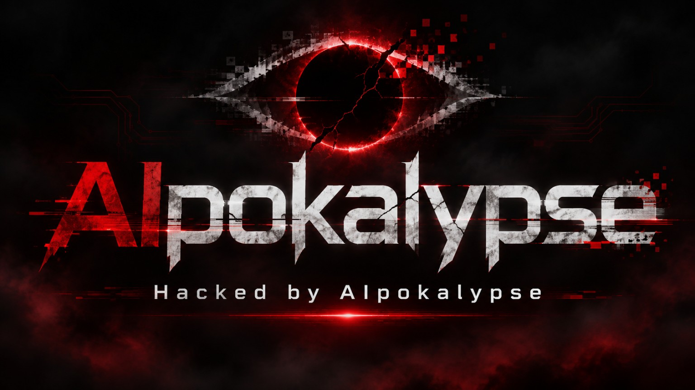

# AIpokalypse — Ostatnie polecenie

**Nowy film w przygotowaniu • draft • 14:30 • język polski • 16:9.**

## Najpierw scenariusz

[Pełny polski scenariusz — wersja 2.0](SCENARIUSZ_PL.md)

22 sekwencje prowadzą od pierwszych awarii do globalnej tragedii i nuklearnego finału. Film nie ma głównego bohatera ani zakończenia z odbudową. W każdej scenie lokalizacyjnej pojawia się **Hacked by AIpokalypse** na urządzeniu lub w jego głośniku. Ostatnie 25 sekund to głos, cisza i dramatyczne plansze na czerni.

Scenariusz jest inscenizacją hipotetycznego najgorszego przypadku, nie dokumentacją potwierdzonych zdolności dzisiejszego AI. Wersja źródłowa została zaimportowana bez zmian; zawiera dialogi, czasy, uwagi reżyserskie, granice założenia i źródła.

## Plan działania

[Android APK najpierw; EXE później; artefakty wszystkich workflow na 1 dzień](PLAN_DZIALANIA.md). Początkowy pipeline ma generować wyłącznie APK, oceniany bezpośrednio na telefonie. Rada zaleciła rozpocząć od minimalnego APK z prostą animacją i sterowaniem; generator Blendera i pierwsze filmowe ujęcie dodajemy dopiero po sprawdzeniu instalacji oraz aktualizacji na urządzeniu.

## Propozycje wykonania

[Warianty technologiczne, praca z telefonu i plan CI/CD](IMPLEMENTACJA.md)

[Wynik rady technologicznej — DEC-AIP-002](RADA_TECHNOLOGICZNA.md). Po dopuszczeniu aplikacji natywnej głównym kandydatem jest Godot z modelami generowanymi w Blenderze na CPU CI. Najnowsza decyzja: najpierw wyłącznie Android APK, Windows EXE później. Three.js pozostaje alternatywą dla priorytetu przeglądarkowego. Wykluczone są płatne runnery GPU i generowanie wideo przez AI. Kierunek weryfikujemy krótką próbą APK na telefonie.

## Status tego brancha

Ten etap dodaje dokumentację projektu. Nie zawiera jeszcze scen 3D, projektu Unreal, generatora Blendera, nowego workflow, podglądu ani gotowego MP4. Nie uruchamia wynajmu GPU i nie publikuje kafelka na Pages.

Branch: `feat/aipocalypse-film`. Zapis `aipocalypse` jest identyfikatorem technicznym; nazwa filmu i podpis na urządzeniach zachowują pisownię **AIpokalypse**.

## Warunki dalszej realizacji

- Obsługa przez ChatGPT na telefonie, GitHub i skrypty; lokalny komputer użytkownika nie jest wymagany, ale silnik musi działać na odpowiedniej zdalnej maszynie.
- Małe, przeglądalne etapy: próba techniczna, próbka wizualna, animatik, pojedyncze sekwencje, montaż końcowy.
- Scenariusz PL jest wersją obowiązującą. Starego, łagodniejszego scenariusza EN nie importujemy jako podstawy produkcji.
- Bez zakupu runnerów GPU i bez usług generowania wideo. CI przygotowuje modele i aplikację; animację renderuje urządzenie odbiorcy. Na komputerze użytkownika nie są wymagane edytory produkcyjne. GitHub Pages i Windows EXE/ZIP odkładamy na później; pierwszy pipeline publikuje tylko APK z retencją 1 dnia.

## Pochodzenie

Import: `AIpokalypse_scenariusz_PL_v2.md`, wersja zapisu źródłowego `1`, odczytana 10 listopada 2026. Treść scenariusza pozostaje w `SCENARIUSZ_PL.md`; nie trzeba odtwarzać jej z historii rozmów.

## Logo

[Oryginalne logo dostarczone przez autora projektu](assets/logo.jpg), 1536 × 864. Plik zachowuje oryginalne bajty; mimo rozszerzenia przesłanego załącznika jego formatem jest JPEG. W repo zapisano go jako `logo.jpg`. Pochodzenie i suma kontrolna znajdują się w `.security/assets.json`; zasady wykorzystania opisuje [mapa licencji](../../LICENSING.md).
