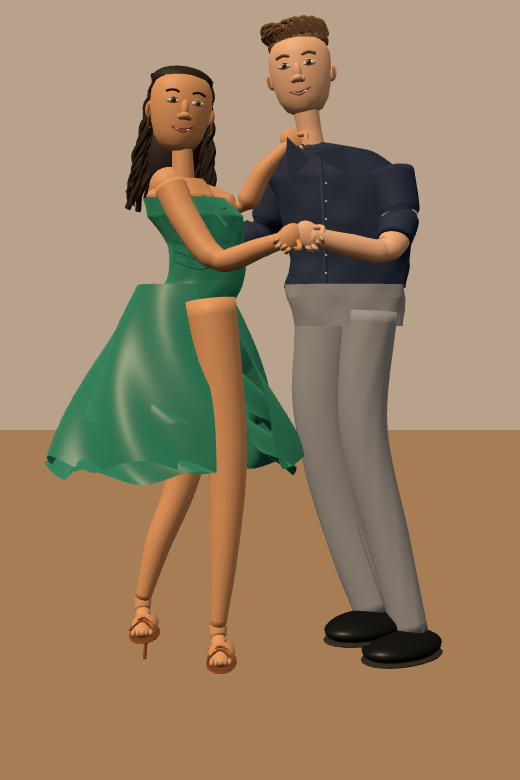
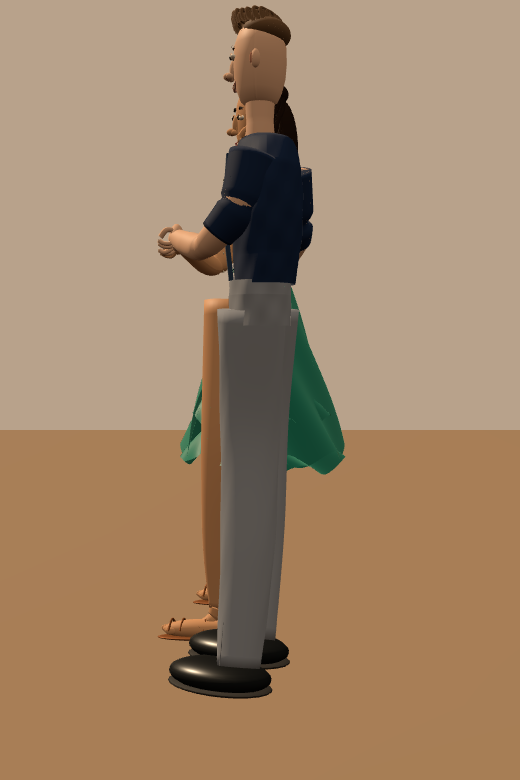
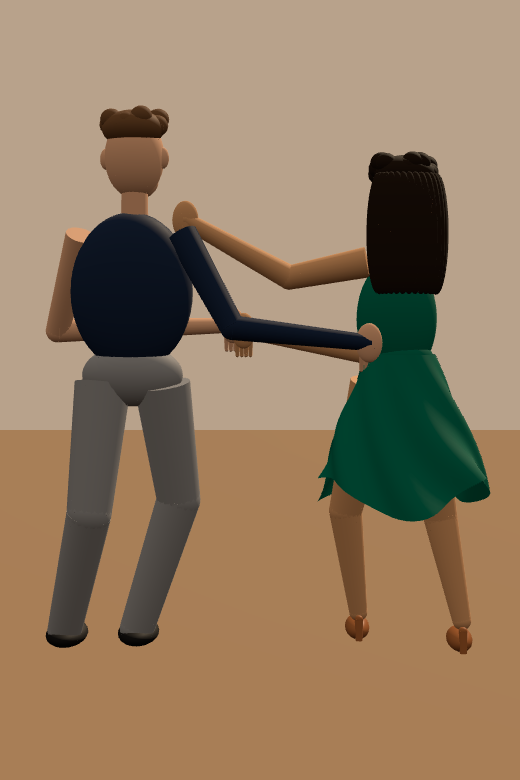

# Emerald & Navy — static reconstruction study

**Status: functioning stylized prototype; reference reconstruction is not complete.**

The source reference is synthetic. Every visible model surface is geometry, not a photograph billboard. No animation or generated video is used. Back surfaces are inferred.

## Run locally

From the repository root:

```sh
npm ci
node experiments/salsa-human-models/prepare.mjs
node experiments/salsa-human-models/serve.mjs
```

Open http://127.0.0.1:3001/ — redirects to the isolated experiment. Drag to orbit, use reference/side/rear camera buttons, or download the static GLB. No production build or Pages changes are required. Exporter code is derived locally from the locked MIT Three.js package; upstream notice remains in vendor/THREE-LICENSE.txt.

## Verify

```sh
npx playwright install chromium
node experiments/salsa-human-models/validate.mjs
python3 experiments/salsa-human-models/diagnostics.py
npm test
npm run build
node scripts/audit-licenses.mjs
```

Diagnostics require Pillow. Browser validation owns port 3001 temporarily, captures three views and the side-by-side page, exports GLB and checks mobile overflow. `output/` is generated locally. `regression.json` stores coarse 16×24 RGB samples: mean absolute RGB error must stay below 3/255 per view. Update intentionally with `diagnostics.py --update` after visual review. This only detects large render changes on a comparable Chromium/SwiftShader environment, not subtle mesh defects or similarity to the concept. Baseline creation and comparison in one environment do not establish cross-platform stability.

## Visual checkpoint

| Front | Side | Rear |
|---|---|---|
|  |  |  |

Original generated renders: CC BY 4.0, Salsa procedural reconstruction by kpok. The concept image retains its separate provenance and rights statement.

## Known limitations / next work

- Faces, hair, hands and shoes are simplified; clothing joins and anatomy remain visibly primitive. No claim of photorealism or identity matching.
- Pose and spacing differ substantially from the concept. Three manually selected image landmarks expose offsets in `review/landmarks.json`; they are diagnostics, not acceptance thresholds.
- Palette occupancy is a coarse lit-pixel heuristic, not a calibrated source/render color difference. Silhouette comparison to the source is still missing.
- GLB includes the model only; lighting and floor belong to the viewer.
- Snapshot CI is implemented as described below. Source similarity CI remains pending. Existing production workflows and deployment retain their main-only restrictions. Keep PR draft until visual reconstruction and full diagnostics are reviewed.

## GitHub Actions snapshot — stage 1

`Salsa fixed-camera snapshot` runs on owner pushes to this experiment branch and main. It runs the existing repository audit, starts the isolated scene with a fixed 34° camera, captures a **1024×1536 PNG**, and uploads `salsa-fixed-camera-snapshot` for **1 day**. Open the run Summary → Download PNG and camera settings, or download it in the Artifacts section. The ZIP contains `render.png` and `capture.json`.

The upload uses `always()` after a successful audit and capture, so a later validation failure cannot suppress an existing screenshot. A failed audit or failed capture does not publish an artifact. There is no deployment and no similarity gate in stage 1. Stage 2 will add the source/render/difference panel, an explicitly defined percentage metric and a failing threshold of 80%, while retaining the snapshot even when that gate fails.

Local snapshot command, after `prepare.mjs` and Playwright installation:

```sh
node experiments/salsa-human-models/capture.mjs
```

The camera is centralized in `camera.js`. It is an approximate reference viewpoint inferred from one image; the original image has no recoverable camera calibration. Snapshot mode changes only page layout, not model geometry or the camera preset.
